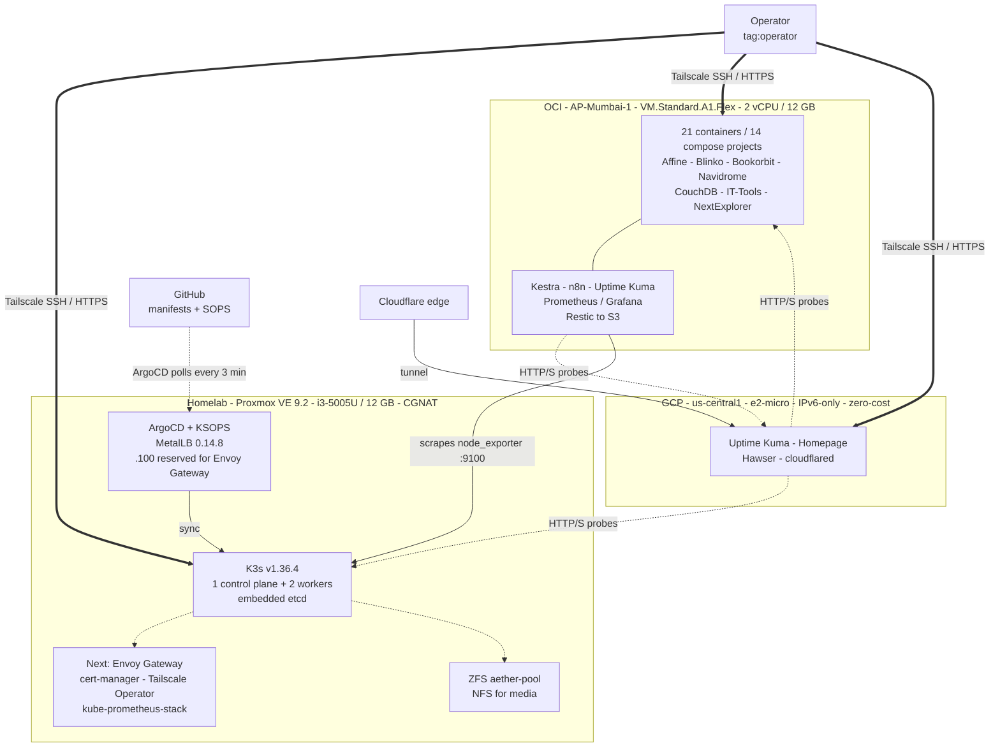

<div align="center">


**A production-style platform spread across a 12 GB notebook, two free-tier clouds, and a zero-trust tailnet.**

[](https://k3s.io)
[](https://argo-cd.readthedocs.io)
[](https://developer.hashicorp.com/terraform)
[](https://tailscale.com)
[](https://getsops.io)
[](https://metallb.universe.tf)

</div>

**Contents:** [Why](#why-this-exists) · [Today](#what-runs-today) · [Architecture](#architecture) · [How it works](#how-it-works) · [IaC](#infrastructure-as-code) · [Operations](#operations) · [Reliability](#reliability-and-recovery) · [Roadmap](#roadmap) · [Docs](#documentation)

> **Status, 2026-10-25.** Phases 01 and 02 are complete. Phase 03 is in progress: the seven namespaces and MetalLB are live, while Envoy Gateway, cert-manager, Tailscale ingress, in-cluster monitoring, and the etcd backup chain are still open. Phase 04 has Kestra running on OCI with three flows; the seven applications have not moved to K3s yet. Phase 05 is about 55% complete.

## Why this exists

Project Aether is a personal platform engineering project built on hardware that was never meant to run one: an HP notebook with an Intel i3-5005U, 12 GB of DDR3, and a 500 GB spinning disk. It sits behind carrier-grade NAT with no public IPv4 and no open ports.

The obvious answer is to rent a cluster. That also removes the constraints that make the project worth doing. Instead, the platform is split across three environments:

- **Homelab.** Proxmox VE 9.2 on the notebook runs three Ubuntu 24.04 VMs. One is the K3s control plane; two are workers. ArgoCD and the platform services live here.
- **OCI.** An Always Free `VM.Standard.A1.Flex` instance in Mumbai runs the applications that do not fit in 12 GB of RAM.
- **GCP.** An Always Free `e2-micro` in `us-central1` runs an external observer on IPv6-only networking, so the alert path sits outside both the homelab and OCI.

A laptop is not a production data center. The point is to practice the parts of platform engineering that survive a hardware change: declarative infrastructure, GitOps, least-privilege networking, secret handling, observability, and recovery.

It started as a way to run a few Docker containers. It is now a three-environment platform with a GitOps control plane. The remaining work is the part that turns a cluster into a platform: ingress, TLS, monitoring, storage, backups, and the application migration.

## What runs today

| Layer | Live now | Where |
|---|---|---|
| Cluster | K3s v1.36.4, one control plane and two workers, Ubuntu 24.04, embedded etcd | Homelab |
| GitOps | ArgoCD + KSOPS, App-of-Apps, five Applications Synced/Healthy | Homelab |
| Load balancing | MetalLB 0.14.8, L2 pool `192.168.1.100-105`, `.100` reserved for Envoy Gateway | Homelab |
| Applications | 21 containers across 14 compose projects | OCI |
| Ops automation | Kestra with three Git-synced flows, n8n, Restic, Prometheus/Grafana | OCI |
| External observer | Uptime Kuma, Homepage, Hawser, cloudflared | GCP |
| IaC | Three Terraform roots, GCS state, Ansible, Taskfile | Git |
| Secrets | SOPS + Age + GCP KMS, KSOPS in ArgoCD | Git and cluster |
| CI | Nightly Terraform drift for the GCP DMZ | GitHub Actions |

**Next:** Envoy Gateway, cert-manager, the Tailscale Operator, kube-prometheus-stack/Loki, the etcd snapshot chain, and the first 4A migration. None of these are deployed yet.

## Architecture

The diagram shows the live path plus the next platform layer. Dashed lines are probes or planned paths.



### Three environments

| | Homelab | OCI | GCP DMZ |
|---|---|---|---|
| Hardware | HP notebook: i3-5005U, 12 GB DDR3, 250 GB SSD and 500 GB HDD | `VM.Standard.A1.Flex`: 2 ARM vCPU, 12 GB RAM, 100 GB boot | `e2-micro`: 2 shared vCPU, 1 GB RAM plus 2 GB swap, 30 GB |
| Platform | Proxmox VE 9.2, Ubuntu 24.04 VMs | Ubuntu 24.04, Docker Compose | Ubuntu 24.04, Docker Compose |
| Role | K3s control plane and GitOps | Applications and ops automation | External observer |
| Network | CGNAT, tailnet only | SSH 22 public, apps tailnet-only | IPv6-only, no public IPv4 |
| Cost | Existing hardware | $0 Always Free | $0 Always Free |

Cloud compute runs on free tiers. The S3-compatible backup bucket is the only line item that may cost money.

## How it works

### The homelab runs the control plane

Proxmox VE 9.2 runs on the notebook. Three Ubuntu 24.04 VMs are cloned from a cloud-init template: `k3s-control-01` (2 vCPU / 2 GB) and two workers (2 vCPU / 3.5 GB each). Terraform clones them with the `bpg/proxmox` provider; Ansible configures the hosts and the cluster.

K3s is pinned at v1.36.4. The control plane uses embedded etcd. A three-server etcd quorum would need two more VMs and roughly 4 GB of RAM, which the 12 GB host does not have to spare. The trade-off is explicit: after a control-plane loss, the cluster is rebuilt from Git and Terraform rather than failed over. The etcd snapshot chain that makes that recovery practical is Phase 03 work.

ArgoCD runs in the cluster. `root-apps` is the only Application applied by hand; it watches `kubernetes/cluster/` and creates the child Applications. The five current Applications (`root-apps`, `platform-namespaces`, `metallb`, `metallb-config`, `smoke-test`) are Synced/Healthy. The seven platform and app namespaces carry Pod Security Admission labels.

MetalLB 0.14.8 advertises a six-address L2 pool, `192.168.1.100-105`. The pool sits outside the router's DHCP range, and `.100` is reserved for Envoy Gateway so the ingress address stays put when the gateway lands.

Storage is `local-path`. Longhorn's minimum footprint is about 1.2-1.5 GB of RAM; on a host that is already split across three VMs, that is too much for storage the applications do not need yet. NFS from the Proxmox ZFS pool is reserved for the 4B media apps. The storage strategy is codified in [ADR-016](docs/adr/016-kubernetes-storage-strategy.md).

### OCI carries the workloads

`bookorbit` is an OCI Always Free `VM.Standard.A1.Flex` instance in AP-Mumbai-1: 2 ARM vCPU, 12 GB RAM, and a 100 GB boot volume. It runs 21 containers across 14 compose projects, including Affine, Blinko, Bookorbit, Navidrome, CouchDB, IT-Tools, NextExplorer, Kestra, n8n, Prometheus/Grafana, Uptime Kuma, and the host tooling (tsdproxy, Dockhand, Dozzle).

The split is driven by memory. The homelab host has 12 GB, split across three VMs and Proxmox; OCI has 12 GB of its own. The applications that need more than the homelab can spare stay on OCI until the migration budget is proven.

Kestra is the ops orchestrator. It runs on OCI with Postgres 16, Tailnet-only access with basic auth, and three Git-synced flows: a nightly Restic backup, a weekly Docker prune, and a six-hour flow sync. n8n stays for webhook glue. Running a second automation stack inside the cluster would cost RAM the cluster does not have.

Restic runs nightly at 03:00 IST to S3-compatible object storage and pings Uptime Kuma on success. The backup includes a logical `pg_dump` of Kestra's Postgres. A Kestra flow at 03:30 UTC runs in parallel while it builds a track record; the legacy cron stays enabled until then. The offsite replica and the restore drill are still open.

OCI apps are published on the tailnet through tsdproxy. The K3s ingress path will use the Tailscale Operator; OCI keeps tsdproxy. `legacy-docker/` holds the retired compose estate for reference; none of it runs.

### GCP is the external witness

`aether-gcp-dmz` is an Always Free `e2-micro` in `us-central1-a`: 2 shared vCPU, 1 GB RAM plus 2 GB swap, and a 30 GB `pd-standard` disk. It has no public IPv4, which avoids the $3.65/month address fee, and accepts SSH only from Tailscale's CGNAT range (`fd7a:115c:a1e0::/48`).

It runs Uptime Kuma, Homepage, Hawser, and `cloudflared`. It probes OCI and the K3s endpoints over the tailnet; OCI probes it back. If one side loses network, the other still has an alert path. The DMZ is deliberately outside the blast radius: it is stateless, and its target rebuild time is 15 minutes.

Homepage talks to the Docker API through a socket proxy with mutations disabled, so a compromised dashboard container cannot POST to the daemon. A systemd drop-in starts Docker after `tailscaled`, which prevents the observer from coming up before its network.

### The tailnet is the network

Tailscale provides the WireGuard overlay. The homelab has no inbound ports, OCI exposes SSH on 22, and GCP has no public IPv4. Every endpoint carries a tag, and the grants are explicit:

| Source | Destination | Port / protocol | Purpose |
|---|---|---|---|
| `tag:operator` | `*` | SSH / HTTPS | Admin access from operator devices |
| `tag:k3s` | `tag:k3s` | Cluster mesh | Pod, service, and node traffic |
| `tag:oci` | `tag:oci` | Container network | Local containers on OCI |
| `tag:gcp-dmz` | `tag:k3s` | 80 / 443 | Synthetic health checks |
| `tag:gcp-dmz` | `tag:oci` | 80 / 443 | Synthetic health checks |
| `tag:oci` | `tag:k3s`, `tag:homelab-dc` | 9100 | Prometheus node_exporter scrape |
| `tag:oci` | `tag:gcp-dmz` | 2376 | Hawser / Dockhand |

`tag:k3s` has no grant to `tag:oci` or `tag:gcp-dmz`. The asymmetry is deliberate. OCI can scrape node_exporter on 9100, but it cannot reach the Kubernetes API or Proxmox. The cluster has no path back to OCI or GCP. That keeps the blast radius small, and it is why Kestra's homelab flows (Terraform drift, etcd snapshots) are still open: a scoped grant is a pending decision.

The tailnet is the perimeter. Inside the cluster, pod-to-pod traffic is still default-allow; default-deny NetworkPolicies are Phase 03 task 3.10.

### GitOps is the delivery path

GitHub is the source of truth. ArgoCD polls the repository every three minutes, so a pushed change lands within 180 seconds. A manifest edited but not pushed does not exist to the cluster.

`root-apps` is the only Application applied by hand. It watches `kubernetes/cluster/`; the child Applications point at `kubernetes/platform/` and `kubernetes/apps/`. Sync waves keep the first sync from racing: `-3` namespaces, `-2` CRDs and operators, `-1` shared secrets, `0` controllers, `1+` applications. New apps use automated sync with `prune` and `selfHeal`.

KSOPS runs as a Config Management Plugin sidecar in the ArgoCD repo-server. It decrypts `*.sops.yaml` files as ArgoCD renders them. The Age key is a Kubernetes secret in the `argocd` namespace, injected by `task k8s:sops-secret`; it is never committed.

The bootstrap path is manual by design: `task k8s:bootstrap-argocd` installs the Helm chart, the KSOPS ConfigMap, and the Age key. Everything after that is reconciled from Git. The layout and the rules for adding an app are in [`kubernetes/README.md`](kubernetes/README.md).

### Secrets stay encrypted in Git

SOPS encrypts secrets to two recipients: an offline Age key and a GCP Cloud KMS key. Either key can decrypt. Losing the local Age key does not lock you out if `gcloud` ADC works; losing cloud access does not lock you out if the Age key is safe.

`*.sops.yaml` and `*.sops.tfvars` are the encrypted file types. The Tailscale access policy is HuJSON stored as a block scalar inside a SOPS file, which preserves the comments that HuJSON exists for. Terraform tasks decrypt tfvars to `.decrypted.auto.tfvars` and remove the file with a shell trap; Ansible variables are SOPS-encrypted; KSOPS handles the in-cluster secrets.

Pre-commit runs gitleaks, a SOPS-encryption check, kubeconform, `terraform fmt`/`validate`, and YAML checks. It catches a plaintext secret before it reaches a commit, but it only protects the local path. CI enforcement and branch protection are still Phase 05 work.

## Infrastructure as code

### Terraform

Three root modules, split by blast radius and state-lock contention rather than by environment tier:

| Root | What it provisions |
|---|---|
| `01-oci-compute` | OCI instance, security lists, subnets, and imports for unmanaged networking |
| `02-gcp-dmz` | GCP VPC, IPv6 subnet, firewall rules, and the DMZ instance |
| `03-homelab` | Proxmox VM clones from the Ubuntu cloud-init template |

`02-gcp-dmz` reads `01-oci-compute` outputs through `terraform_remote_state`, so the DMZ firewall can allow the OCI address without a copied value. `03-homelab` uses `bpg/proxmox` with `insecure = false` and a valid Let's Encrypt certificate.

State lives in `gs://tf-backend-oci-hlab-gcs/` under separate prefixes, with GCS locking and five versions of history.

### Ansible

Playbooks are split so a change does not re-run the whole estate: `common.yml`, `control.yml`, `workers.yml`, `kubeconfig.yml`, `bootstrap-oci.yml` (with `oci-base`, `oci-apps`, `oci-monitoring`, `oci-ops`), and `deploy-dmz.yml`.

OCI app deploys are tagged per service: `task ansible:oci:apps -- --tags n8n`. The GCP DMZ playbook adds the Docker-after-tailscaled drop-in and the socket proxy. Inventory host-key checking is `accept-new`, so the first bootstrap works and later key changes fail.

### CI and guardrails

The only workflow is a nightly Terraform drift check at 02:00 UTC. It authenticates to GCP with a service-account key from GitHub secrets, runs `terraform plan -detailed-exitcode` for `02-gcp-dmz`, and fails on drift. Dependabot checks the DMZ Docker images monthly.

The workflow covers one of the three roots. There is no pull-request validation, no SOPS check in CI, and branch protection is not enabled yet. Phase 05 closes those gaps.

## Operations

The Taskfile is the operator interface. Terraform tasks decrypt SOPS tfvars to a temporary `.decrypted.auto.tfvars` and remove it with a trap on exit, so a failed apply does not leave plaintext on disk.

```bash
task                         # list tasks
task tf:plan DIR=03-homelab
task tf:apply DIR=03-homelab
task ansible:bootstrap       # common -> control -> workers -> kubeconfig
task ansible:oci             # converge OCI
task ansible:dmz             # GCP DMZ
task k8s:bootstrap-argocd    # ArgoCD + KSOPS
task argocd:password
task argocd:port-forward
task encrypt FILE=path/to/secret.yaml
```

These are operator commands, not a one-command demo. They assume the tailnet, cloud credentials, and SOPS keys are already in place. ArgoCD is currently reached through `kubectl port-forward` on `localhost:8090`; the Tailscale Operator will replace that in Phase 03.

## Reliability and recovery

The recovery targets are documented, but not all of them are achieved yet. The K3s etcd snapshot schedule and offsite copy are still Phase 03 work; until they land, the cluster RPO is whatever the last manual snapshot captured.

| Component | RTO | RPO | Mechanism | State |
|---|---|---|---|---|
| K3s control plane | 30 min | 0-24 h | etcd snapshots and rebuild | Schedule pending |
| OCI apps and databases | 45 min | 24 h | Restic to S3 | Live; offsite copy pending |
| GCP DMZ | 15 min | 0 | Terraform and Compose | Live |
| Secrets and network access | 15 min | 0 | SOPS dual-key and break-glass SSH | Live |
| Terraform state | 10 min | 0 | GCS versions | Live |

Five failure drills are written: Tailscale outage, OCI loss and Restic restore, homelab hardware and etcd recovery, Age key loss and KMS recovery, and GCP DMZ rebuild. They are in [`docs/disaster-recovery/`](docs/disaster-recovery/). A successful `restic copy` is not the success criterion; a restore is.

The design assumption is that the VMs are disposable. Git, Terraform, and SOPS are the source of truth; OCI holds the state that needs backups. That is why the cluster is rebuilt rather than failed over.

## Roadmap

| Phase | Scope | State |
|---|---|---|
| 01 | Multi-cloud foundation: Proxmox, K3s, Tailscale, SOPS, Ansible, OCI, GCP DMZ | Complete |
| 02 | GitOps foundation: ArgoCD, App-of-Apps, KSOPS, namespaces, smoke test | Complete |
| 03 | Core platform: Envoy Gateway, cert-manager, Tailscale Operator, monitoring, storage, etcd backups | In progress: namespaces and MetalLB live |
| 04 | Applications and migration: Kestra ops, 4A sensitive apps, then 4B | In progress: Kestra live, migration not started |
| 05 | CI/CD and polish: PR CI, branch protection, docs, ADRs, runbooks | In progress: about 55% |

Phase 03 is the critical path. Envoy Gateway and cert-manager unlock TLS; the Tailscale Operator removes the ArgoCD port-forward; kube-prometheus-stack replaces the OCI Prometheus; the etcd snapshot chain closes the biggest DR gap. NetworkPolicies and the storage ADR follow.

Phase 04 starts with the four sensitive apps: Affine, Blinko, Bookorbit, and CouchDB. Navidrome, IT-Tools, and NextExplorer are deferred until the 4A set is stable and the worker memory budget is measured. Migration is a parallel run, not a cutover: each OCI service stays up until its K3s replacement is proven.

Phase 05 runs in parallel: pull-request validation, a SOPS check in CI, branch protection, and the remaining ADRs and runbooks. None of it blocks the platform work.

## Documentation

| ADR | Decision |
|---|---|
| [001](docs/adr/001-hypervisor-selection.md) | Proxmox on the notebook instead of bare-metal Docker |
| [002](docs/adr/002-storage-topology.md) | Dual-tier storage: SSD for the OS and VMs, ZFS HDD for bulk |
| [003](docs/adr/003-kubernetes-distribution.md) | K3s over Talos |
| [004](docs/adr/004-network-access.md) | Tailscale for remote access |
| [005](docs/adr/005-mono-repo-structure.md) | One monorepo for infrastructure, Kubernetes, and docs |
| [007](docs/adr/007-secrets-management.md) | SOPS with Age and GCP Cloud KMS |
| [009](docs/adr/009-gitops-controller.md) | ArgoCD over Flux |
| [011](docs/adr/011-terraform-remote-backend.md) | GCS remote state |
| [013](docs/adr/013-tailnet-microsegmentation.md) | Tailscale Grants instead of flat ACLs |
| [014](docs/adr/014-infrastructure-environment-isolation-strategy.md) | Single environment, namespace isolation, VM rollback |
| [015](docs/adr/015-ci-validation-pipeline.md) | PR validation and a phased drift pipeline (proposed) |
| [016](docs/adr/016-kubernetes-storage-strategy.md) | Kubernetes storage strategy: local-path default, Longhorn rejected, NFS for media |
| [019](docs/adr/019-centralized-logging-architecture.md) | Centralized logging: Grafana Loki on OCI, lightweight Promtail on K3s, Tailscale mesh transit |

ADR-017 (Kestra) and ADR-018 (GCP DMZ) are still open. The decisions are settled; the records are not written.

Also in the repo:

- [Runbooks](docs/runbooks/): Proxmox cloud-init, Proxmox ACME TLS, Tailscale key rotation, ArgoCD recovery, GCP drift detector setup.
- [Disaster recovery](docs/disaster-recovery/): RTO/RPO, break-glass access, five scenarios.
- [Kubernetes layout](kubernetes/README.md): ArgoCD ownership, sync waves, SOPS rules, adding an app.
- [Kestra flows](automation/kestra/flows/): Restic, Docker prune, flow sync.
- [Diagram source](docs/diagrams/project-aether-architecture.excalidraw): the Excalidraw version of the architecture.

<details>
<summary>Repository layout</summary>

```text
Project Aether/
├── .github/
│   ├── workflows/terraform-drift.yml
│   └── dependabot.yml
├── automation/kestra/flows/
│   ├── ops/oci-docker-prune.yml
│   ├── ops/restic-nightly.yml
│   └── system/git-sync-flows.yml
├── docs/
│   ├── adr/                     # 001-015
│   ├── disaster-recovery/       # RTO/RPO and five scenarios
│   ├── diagrams/                # banner and Excalidraw source
│   └── runbooks/                # five operational runbooks
├── infrastructure/
│   ├── ansible/                 # inventory, playbooks, templates
│   ├── secrets/                 # SOPS-encrypted variables and policies
│   └── terraform/
│       ├── 01-oci-compute/
│       ├── 02-gcp-dmz/
│       └── 03-homelab/
├── kubernetes/
│   ├── bootstrap/argocd/        # Helm values and KSOPS CMP
│   ├── cluster/                 # root App-of-Apps and child Applications
│   ├── platform/                # namespaces and smoke test
│   └── apps/                    # migration target, empty today
├── scripts/                     # SOPS check and K3s comparison
├── legacy-docker/               # archived compose files, not running
├── Taskfile.yaml
├── .sops.yaml
└── .pre-commit-config.yaml
```

</details>

<div align="center">
  <sub>Last updated 2026-10-25 · Built and operated by <a href="https://github.com/ChetanThapliyal">Chetan Thapliyal</a></sub>
</div>
