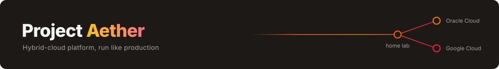
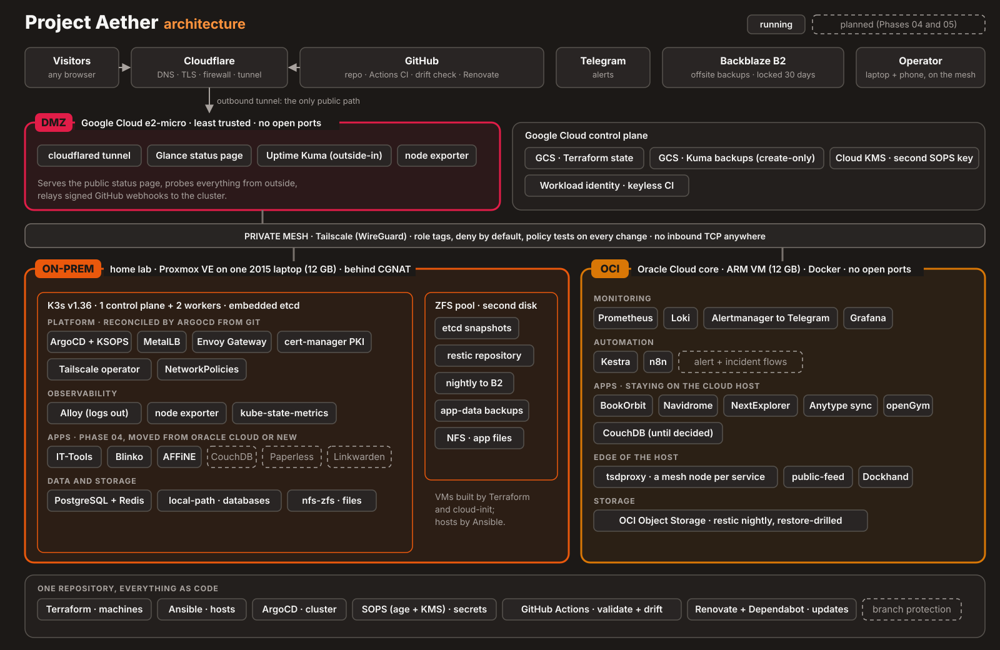
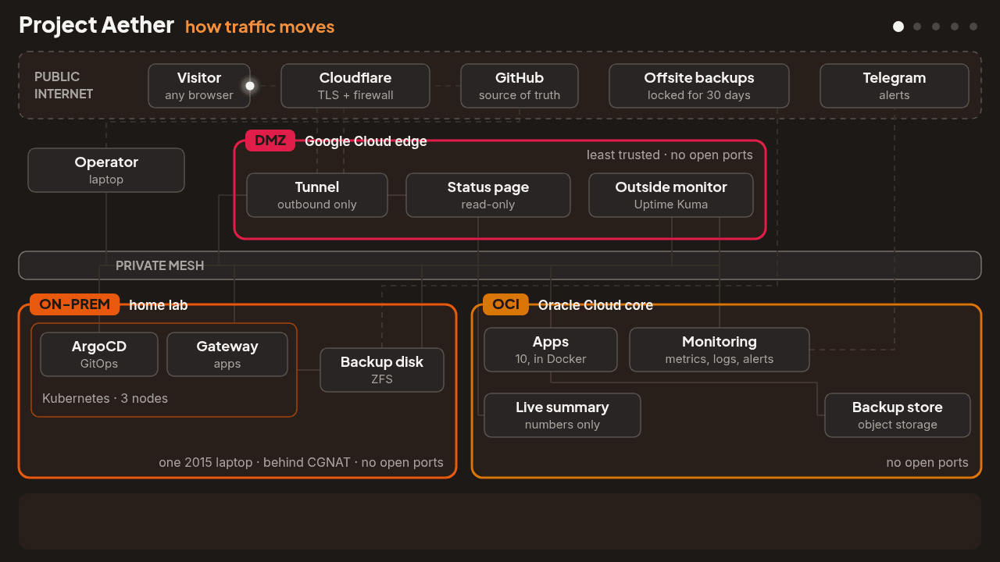

<div align="center">



**A hybrid-cloud platform run to production standards: Kubernetes on a 12 GB laptop, two free-tier clouds, and a private mesh between them.**

[](https://status.chetan-thapliyal.cloud)
[](https://k3s.io)
[](https://argo-cd.readthedocs.io)
[](https://developer.hashicorp.com/terraform)
[](https://tailscale.com)
[](https://getsops.io)

</div>

**Contents:** [Overview](#overview) · [Architecture](#architecture) · [How it works](#how-it-works) · [Security](#security) · [Reliability](#reliability-and-recovery) · [Infrastructure as code](#infrastructure-as-code) · [Operations](#operations) · [Status](#status-and-roadmap) · [Documentation](#documentation)

## Overview

Project Aether is a personal platform engineering project. It runs a three-node Kubernetes cluster on a 2015 laptop at home, a monitoring and automation host on Oracle Cloud, and a deliberately low-trust observer on Google Cloud. The three sites are joined by a WireGuard mesh and declared in this repository: Terraform builds the machines, Ansible configures the hosts, ArgoCD reconciles the cluster, and SOPS keeps the secrets encrypted in Git.

The hardware is modest on purpose. The laptop sits behind carrier-grade NAT with no public address, and both clouds run on always-free tiers. Those limits force the decisions that make platform work interesting: what runs where, what may talk to what, how a failure is noticed, and how the system comes back.

No customers depend on it. The data, the backups and the attack surface are real, so it is operated like production: every change goes through Git, every real failure gets a written review, and every backup has to pass a restore.

**See it running:** the [status page](https://status.chetan-thapliyal.cloud) shows live cluster health, recovery objectives with the age of each newest backup, incident response times, and the network design.

### What it demonstrates

| Area | In practice |
|---|---|
| GitOps | ArgoCD app-of-apps with KSOPS. A push reaches the cluster in about a second through a signed webhook, and a drift check guards the bootstrap layer |
| Zero-trust networking | No inbound TCP port from the internet on any machine. Role-based mesh rules with policy tests that reject a bad change at save time |
| Observability | Metrics, logs and alerting hosted off the cluster, plus an outside observer and a dead-man's switch for the alert path itself |
| Disaster recovery | 3-2-1 backups with an Object-Locked offsite copy. Restores are drilled and timed, and each backup stage reports a heartbeat |
| Security | Secrets encrypted for two independent keys, keyless CI, pinned images, default-deny NetworkPolicies, a strict content policy on the public page |
| Operations | 13 blameless incident reviews, five recovery scenarios, runbooks, and a sign-off checklist for each phase |

## Architecture

Solid boxes run today. Dashed boxes are planned (see [Status and roadmap](#status-and-roadmap)).



How traffic moves through it, one flow at a time:



### Three environments

| | On-prem home lab | Oracle Cloud (OCI) | Google Cloud (DMZ) |
|---|---|---|---|
| Hardware | HP laptop: i3-5005U, 12 GB RAM, SSD plus a 500 GB HDD | `VM.Standard.A1.Flex`: 2 ARM OCPU, 12 GB RAM | `e2-micro`: 2 shared vCPU, 1 GB RAM |
| Platform | Proxmox VE, three Ubuntu VMs, K3s | Ubuntu, Docker Compose | Ubuntu, Docker Compose |
| Role | Kubernetes cluster and GitOps | Monitoring, automation and applications | Outside observer and the public status page |
| Exposure | Behind CGNAT, no port forwards | No inbound TCP | No public IPv4, no inbound TCP |
| Cost | Existing hardware | Always free | Always free |

## How it works

### Cluster and platform

Proxmox VE runs three Ubuntu VMs cloned from a cloud-init template: one K3s control plane and two workers. Terraform creates them with the `bpg/proxmox` provider, and Ansible installs and configures K3s.

The control plane uses embedded etcd on a single server. A three-server quorum would need about 4 GB more memory than the host has. The trade-off is explicit: after a control-plane loss the cluster is restored from a snapshot or rebuilt from Git, not failed over. The backup chain below exists to make that fast.

On the cluster, the Tailscale operator publishes Envoy Gateway and ArgoCD on the mesh, and cert-manager issues a Let's Encrypt wildcard certificate for app names that resolve only on the mesh ([ADR-021](docs/adr/021-internal-dns-and-pki.md)). Databases use `local-path`; app files use NFS from the ZFS pool, and Longhorn was rejected for its memory footprint ([ADR-016](docs/adr/016-kubernetes-storage-strategy.md)).

### GitOps delivery

GitHub is the source of truth. `root-apps` is the only Application applied by hand. It watches `kubernetes/cluster/` and creates the 16 child Applications, ordered by sync waves so namespaces, operators and secrets land before the things that need them.

A push triggers a signed GitHub webhook. It enters through Cloudflare, which admits only GitHub's address ranges, travels down the outbound tunnel to the DMZ, crosses the mesh, and reaches ArgoCD, which verifies the signature and pulls the change. Reconciliation starts about a second after the push. The three-minute poll remains as a fallback.

KSOPS runs as a sidecar in the ArgoCD repo server and decrypts `*.sops.yaml` files while rendering. The bootstrap itself (the ArgoCD Helm release) is installed by `task k8s:bootstrap-argocd`, and `task argocd:drift` fails when the live release differs from Git. The layout and the rules for adding an app are in [`kubernetes/README.md`](kubernetes/README.md).

### Monitoring and automation core

The Oracle Cloud host runs Prometheus, Loki, Alertmanager and Grafana. Keeping them off the cluster means monitoring survives a home lab outage, which has happened ([INC-2026-012](docs/incidents/INC-2026-012-hypervisor-hung-after-kernel-panic.md)). Prometheus scrapes the cluster nodes, ArgoCD and the hypervisor over the mesh. Grafana Alloy on every node ships logs to Loki. Alertmanager sends alerts to Telegram.

Kestra is the operations scheduler ([ADR-017](docs/adr/017-automation-and-scheduling.md)), with flows synced from [`automation/kestra/flows/`](automation/kestra/flows/): the nightly backup, a weekly Docker prune, and the flow sync itself. The same host runs the applications that have not moved to the cluster yet. Each one is published on the mesh by tsdproxy as its own node with a role tag: app, admin or probe.

### The DMZ observer

The Google Cloud VM is the least-trusted machine and is treated that way. It runs Uptime Kuma, the Glance status page, a node exporter and `cloudflared`. It has no public IPv4 address and no Docker management agent, and its mesh role can reach only probe-tagged services and the cluster's front door.

It watches the other two sites from outside, and they watch it. If either side loses its network, the other still has an alert path. The backup jobs report heartbeats to it, and so does Alertmanager, so a silent backup or a dead alert pipeline raises an alarm of its own.

The public status page reads a sanitised, numbers-only summary from the monitoring core over the mesh. Visitors reach the page through Cloudflare and never touch the private network ([ADR-020](docs/adr/020-public-observability-data-diode.md)).

### The mesh

Tailscale provides the WireGuard overlay. Every machine and every published service carries a role tag, and access is granted between roles, deny by default:

| From | To | For |
|---|---|---|
| Operator devices | every zone | Admin and SSH; personal devices re-authenticate every 12 hours |
| DMZ observer | probe services, cluster ingress | HTTPS checks, the webhook relay, the status summary |
| Monitoring core | cluster nodes, hypervisor, DMZ | Metrics scrapes; probes and heartbeats to the DMZ monitor |
| Cluster nodes | monitoring core | Log shipping only |
| Hypervisor | DMZ observer | Backup heartbeats |

The policy carries tests. Saving a change that would let the DMZ reach an admin tool is rejected by the control plane before it takes effect ([ADR-013](docs/adr/013-tailnet-microsegmentation.md)).

## Security

- **No inbound TCP from the internet** on any machine, and no host with public SSH. Break-glass SSH goes through Google's Identity-Aware Proxy, gated by IAM.
- **One public path.** A Cloudflare tunnel, opened outbound by the DMZ, serves the status page and accepts signed GitHub webhooks on a single path. [ADR-004](docs/adr/004-network-access.md) lists every public entry point, including one legacy exception that is scheduled for removal.
- **Secrets** are SOPS-encrypted for two independent recipients, an age key and a Cloud KMS key. Either one alone can decrypt, and that is tested. A pre-commit hook and CI both reject a plaintext secret.
- **Keyless CI.** GitHub Actions gets short-lived cloud credentials through workload identity federation, only from `main`, with read-only access to infrastructure state. The project holds no long-lived service-account keys, and every deploy of the status page counts them.
- **Least privilege by default.** The DMZ's service account can create backup objects and cannot read, replace or delete them. Platform namespaces are default-deny, and only the Envoy proxy may reach application pods.
- **Supply chain.** Container images are pinned by tag and digest. Renovate and Dependabot propose updates; database major versions are never proposed automatically.
- **The public page** sends a strict Content-Security-Policy with per-page script hashes, and a deploy fails if the live headers differ from the repository.

## Reliability and recovery

Recovery targets are shown next to what has been proven. The live version, with the age of each newest backup, is on the [status page](https://status.chetan-thapliyal.cloud/observability).

| Component | Target RTO | Target RPO | Proven |
|---|---|---|---|
| Kubernetes cluster | 30 min | 24 h | Restore from the offsite copy: API ready 54 s after reset. In-place reset: about 18 min |
| Applications on Oracle Cloud | 45 min | 24 h | One app restored and its database compared with live: 29 s for 1 GB and 176 tables. Full instance rebuild not yet timed |
| Applications on the cluster | 30 min | 24 h | Every app database loaded from its nightly dump and matched against the dump-time counts: 22 s for 4 databases. Offsite copy downloaded and decrypted. No apps live yet |
| DMZ observer | 15 min plus data restore | 24 h | Monitor data restored from the backup bucket and checked. VM rebuild not yet timed |
| Secrets access | 15 min | none lost | Each key decrypts alone |
| Infrastructure state | 10 min | none lost | Versioned bucket |

**Backups.** The cluster's etcd is snapshotted nightly, pulled to a ZFS pool on a second disk, committed to an encrypted restic repository, and copied to Backblaze B2 as an object that is locked for 30 days ([ADR-018](docs/adr/018-offsite-backup-and-3-2-1-disaster-recovery-strategy.md)). The Oracle Cloud applications are backed up nightly with restic, with database dumps taken first. The cluster's app databases are dumped nightly onto the ZFS pool; the hypervisor then snapshots app files and dumps together and ships them, age-encrypted, to the same locked bucket ([ADR-022](docs/adr/022-app-data-storage-and-backups.md)). The DMZ's monitor data goes to a bucket its VM can only add to. The home lab jobs refuse to run if their target is not the expected ZFS dataset, and every job reports a heartbeat only if all of its steps succeeded.

**Drills.** Five failure scenarios are written in [`docs/disaster-recovery/`](docs/disaster-recovery/): a mesh outage, loss of the cloud host, home lab hardware failure, loss of the age key, and a DMZ rebuild. `task dr:drill:oci` and `task dr:drill:k8s` restore application databases into throwaway databases and compare them with the live ones, without touching production.

**Incidents.** Every real failure gets a blameless review in [`docs/incidents/`](docs/incidents/): 13 so far. When an alert caught the problem, the median time to detect was 2 minutes. Problems found by audit instead had been latent for a median of 3 days, which is the reason for the heartbeats, policy tests and sign-off checks above. Each review ends with the guardrail that would have caught it.

**Known limits.** One hypervisor and one control-plane node mean a hardware failure is an outage, not a failover. The Oracle Cloud backups live in the same tenancy as the host they protect. The full rebuild drills for the cloud host and the DMZ have not been timed.

## Infrastructure as code

**Terraform.** Four roots, split by blast radius:

| Root | Provisions |
|---|---|
| `01-oci-compute` | The Oracle Cloud instance, its network and its backup bucket |
| `02-gcp-dmz` | The DMZ network, firewall, VM, service account and backup bucket |
| `03-homelab` | The Proxmox VMs, cloned from a cloud-init template |
| `04-backblaze-b2` | The offsite buckets and their write-only keys |

State is in a versioned Google Cloud Storage bucket. The bucket, the KMS key and the CI identity belong to a separate foundation repository, so no root can destroy what it depends on ([ADR-011](docs/adr/011-terraform-remote-backend.md)).

**Ansible.** Playbooks are split per concern and tagged per service, so one app can be redeployed without touching the rest: `task ansible:oci:apps -- --tags n8n`.

**CI.** `validate.yml` runs on every push and pull request: the pre-commit hooks (secret scanning, the SOPS encryption check, kubeconform, `terraform fmt`), a Helm values lint and `promtool`, with tool versions pinned in `mise.toml`. `terraform-drift.yml` plans three roots every night without stored credentials and fails on drift. Because the repository is public, its log lists only the address of each drifted resource, never values ([ADR-015](docs/adr/015-ci-validation-pipeline.md)).

## Operations

The Taskfile is the operator interface. Terraform tasks decrypt their variables to a temporary file and remove it on exit, so a failed apply leaves no plaintext on disk.

```bash
task                                  # list tasks
task tf:plan DIR=02-gcp-dmz           # plan one Terraform root
task ansible:bootstrap                # build the cluster: common, control, workers, kubeconfig
task ansible:oci:apps -- --tags n8n   # deploy one app on the cloud host
task ansible:dmz                      # deploy the DMZ and the status page
task k8s:bootstrap-argocd             # install or upgrade ArgoCD with KSOPS
task argocd:drift                     # fail if the live ArgoCD release differs from Git
task dr:drill:oci                     # restore drill, read-only to production
```

These are operator commands, not a one-command demo. They assume mesh access, cloud credentials and the SOPS keys.

## Status and roadmap

The foundation, GitOps and platform phases are complete, and each was re-audited against the live systems and hardened afterwards. Two phases are still open.

| Phase | Scope | State |
|---|---|---|
| 01 | Foundation: Proxmox, K3s, the mesh, secrets, both clouds | Complete, hardened and signed off |
| 02 | GitOps: ArgoCD, app-of-apps, KSOPS, CI validation, webhook delivery | Complete, hardened and signed off |
| 03 | Platform: ingress, certificates, private access, monitoring, logging, backups, NetworkPolicies | Complete, hardened and signed off |
| 04 | Applications: move seven apps from Oracle Cloud onto the cluster | In progress. Automation is live. App-data backups come first, then the apps move one at a time, each running in parallel until proven |
| 05 | CI and documentation polish | In progress. Validation and drift detection are live; branch protection and the remaining diagrams are open |

## Documentation

**Architecture decisions** ([`docs/adr/`](docs/adr/)):

| ADR | Decision |
|---|---|
| [001](docs/adr/001-hypervisor-selection.md) | Proxmox on the laptop instead of bare-metal Docker |
| [002](docs/adr/002-storage-topology.md) | Two storage tiers: SSD for the OS and VMs, ZFS on the HDD for backups |
| [003](docs/adr/003-kubernetes-distribution.md) | K3s over Talos |
| [004](docs/adr/004-network-access.md) | A mesh for operators, and an inventory of every public entry point |
| [005](docs/adr/005-mono-repo-structure.md) | One repository for infrastructure, Kubernetes and docs |
| [006](docs/adr/006-proxmox-vm-provisioning-strategy.md) | VMs from Terraform and a cloud-init template |
| [007](docs/adr/007-secrets-management.md) | SOPS with age and Cloud KMS |
| [008](docs/adr/008-operational-toolchain.md) | Taskfile, pre-commit hooks and a pinned toolchain |
| [009](docs/adr/009-gitops-controller.md) | ArgoCD over Flux |
| [010](docs/adr/010-orchestration-migration.md) | Moving workloads from Docker Compose to Kubernetes |
| [011](docs/adr/011-terraform-remote-backend.md) | Remote state in GCS, owned by a separate foundation |
| [012](docs/adr/012-oci-monorepo-consolidation.md) | Oracle Cloud infrastructure in this repository |
| [013](docs/adr/013-tailnet-microsegmentation.md) | Role tags, grants and policy tests on the mesh |
| [014](docs/adr/014-infrastructure-environment-isolation-strategy.md) | One environment, isolated by namespace, with VM rollback |
| [015](docs/adr/015-ci-validation-pipeline.md) | Validation on every push, keyless nightly drift detection |
| [016](docs/adr/016-kubernetes-storage-strategy.md) | `local-path` for databases, NFS from ZFS for app files, Longhorn rejected |
| [017](docs/adr/017-automation-and-scheduling.md) | One scheduler per job: Kestra on the cloud host, CronJobs on the cluster, timers on the hypervisor |
| [018](docs/adr/018-offsite-backup-and-3-2-1-disaster-recovery-strategy.md) | 3-2-1 backups with an Object-Locked offsite copy |
| [019](docs/adr/019-centralized-logging-architecture.md) | Loki on the cloud host, Alloy agents on the cluster |
| [020](docs/adr/020-public-observability-data-diode.md) | The public status page and its one-way data feed |
| [021](docs/adr/021-internal-dns-and-pki.md) | Internal names and certificates: a Let's Encrypt wildcard on names only the mesh can reach |
| [022](docs/adr/022-app-data-storage-and-backups.md) | App data: one shared database, files on NFS, nightly dumps to the Object-Locked bucket, drilled |

**Also in the repository:**

- [Incident reviews](docs/incidents/): 13 blameless reviews with timelines, root causes and guardrails.
- [Disaster recovery](docs/disaster-recovery/): objectives, break-glass access and five scenarios with drills.
- [Runbooks](docs/runbooks/): ArgoCD recovery, mesh key rotation, the Proxmox template and TLS, the drift detector, and the status page's security headers.
- [Kubernetes layout](kubernetes/README.md): what ArgoCD owns, sync waves, secret rules, and how to add an app.
- [Architecture diagram](docs/diagrams/project-aether-architecture.svg), generated by [`build_architecture.py`](docs/diagrams/build_architecture.py).

<details>
<summary>Repository layout</summary>

```text
Project Aether/
├── .github/
│   ├── workflows/               # validate.yml, terraform-drift.yml
│   └── dependabot.yml
├── automation/kestra/flows/     # backup, Docker prune, flow sync
├── docs/
│   ├── adr/                     # 20 architecture decisions
│   ├── diagrams/                # banner, architecture SVG and its generator
│   ├── disaster-recovery/       # objectives and five scenarios
│   ├── incidents/               # 13 incident reviews
│   └── runbooks/                # six operational runbooks
├── infrastructure/
│   ├── ansible/                 # inventory, playbooks, templates
│   ├── docker/gcp-dmz/          # the DMZ stack and the status page
│   ├── secrets/                 # SOPS-encrypted variables and the mesh policy
│   └── terraform/               # 01-oci-compute, 02-gcp-dmz, 03-homelab, 04-backblaze-b2
├── kubernetes/
│   ├── bootstrap/argocd/        # Helm values and the KSOPS plugin
│   ├── cluster/                 # root app-of-apps and child Applications
│   ├── platform/                # ingress, certificates, mesh operator, policies, monitoring
│   └── apps/                    # application manifests (Phase 04)
├── legacy-docker/               # the cloud host's compose files, and a retired archive
├── scripts/                     # CI checks and the restore drill
├── Taskfile.yaml
├── mise.toml                    # pinned tool versions
├── renovate.json
└── .sops.yaml
```

</details>

<div align="center">
  <sub>Built and operated by <a href="https://github.com/ChetanThapliyal">Chetan Thapliyal</a> · <a href="https://status.chetan-thapliyal.cloud">live status</a></sub>
</div>
