```text
================================================================================
ADR-009: GitOps Controller Selection (ArgoCD vs Flux)
================================================================================
```
- **Status:** Accepted (ArgoCD runs the cluster; status corrected 15 Nov 2026)
- **Date:** September 2026
- **Owner:** Principal Architect / Homelab Owner
- **Context:** The homelab cluster operates under a 12GB total RAM constraint, leaving roughly 3.0 GB of allocatable memory on Worker-02 for applications and platform controllers. Reducing the self-hosted catalog from 34 to 5 or 6 core services and moving non-essential workloads to an external OCI instance freed sufficient memory to consider a heavier GitOps controller.
- **Problem Statement:** How do we establish a declarative GitOps synchronization loop for cluster applications and infrastructure without exhausting the ~3.0 GB memory budget on Worker-02?
- **Decision Drivers:**
  - Hands-on experience with standard GitOps tools.
  - Strict memory limits on Worker-02.
  - Real-time visibility into deployment health and Kubernetes resource trees.
- **Decision:** Deploy ArgoCD as the GitOps controller for Project Aether.
- **Architecture Impact:** ArgoCD manages application deployments, monitoring stacks, and platform services within the cluster. It reconciles manifests from the GitHub repository and runs on Worker-02.
- **Alternatives Considered:**
  - *Flux v2:* Rejected. While memory usage is low (~150MB RAM), Flux lacks a native web UI without add-ons like Weave GitOps. ArgoCD provides built-in UI visualization for deployment state and mirrors common production patterns.
- **Decision Rationale:** Offloading secondary applications provided sufficient memory overhead on Worker-02 to run ArgoCD. The built-in web UI and visual diffing simplify troubleshooting in this environment compared to the resource savings of Flux.
- **Consequences:**
  - *Positive:* Integrated web UI for application health and visual diffing; common industry adoption.
  - *Negative:* Higher baseline memory consumption.
  - *Risks:* ArgoCD components (Redis, Dex, Repo Server) could spike in memory usage and trigger pod evictions if limits are misconfigured.
  - *Trade-offs:* Allocating ~500MB of RAM in exchange for built-in visual inspection and manual sync controls.
- **Security Considerations:** The ArgoCD web interface is restricted to internal ingress routes without public internet exposure.
- **Reliability Considerations:** Running workloads continue operating if ArgoCD becomes unavailable, but new Git changes will not reconcile until it recovers.
- **Scalability Considerations:** Adequately handles the scale of 5 to 6 local applications and cluster manifests.
- **Performance Considerations:** Consumes a measurable portion of Worker-02's memory (recommended 500Mi+ limit).
- **Operational Considerations:** Requires setting resource requests and limits in Helm values to avoid starving neighbor pods.
- **Cost Considerations:** Infrastructure: ₹0.00 (open source).
- **Migration Plan:** Install via Helm during bootstrap, then use the "App of Apps" pattern for cluster self-management.
- **Validation / Fitness Functions:**
  - Combined ArgoCD components must stay below 1GB of RAM in a steady state.
  - Commits to the `main` branch must reconcile in the cluster within three minutes.
- **Dependencies:** GitHub repository, K3s cluster, Helm.
- **Open Questions:** Selection of the secrets decryption plugin (KSOPS versus SOPS wrapper) inside ArgoCD.
- **Related ADRs:** ADR-007 (Secrets Management), ADR-008 (Operational Toolchain).
- **Review Conditions:** Review if Worker-02 encounters MemoryPressure or out-of-memory evictions after deploying all target applications.

### Addendum: Implementation Check (2026-11-15)
The status line said "Proposed" long after ArgoCD went into service. It was corrected on 15 Nov, and the body was checked against the running cluster:

- **Placement:** every ArgoCD component is pinned to Worker-02 with a node selector, as decided.
- **Memory:** about 660 MiB in steady state (application controller 328 MiB, repo server 223 MiB, server 75 MiB, Redis 32 MiB), under the 1 GB budget above. Dex and notifications are disabled. The ApplicationSet controller is scaled to zero, because chart 7.8.26 ignores its `enabled` flag.
- **Version history:** ArgoCD v2.14.10 on chart 7.8.26 from 20 October. That release links the Kubernetes client libraries at v0.31, which predate fields the cluster (Kubernetes 1.36) fills in, such as `.status.terminatingReplicas`. ArgoCD couldn't build a diff for the four apps that use server-side apply, so they showed `Unknown` while it could no longer manage them ([INC-2026-005](../incidents/INC-2026-005-gitops-blind-to-drift.md)). Upgraded on 10 Nov 2026 to **v3.5.7 on chart 10.11.7** (Kubernetes libraries v0.36), with an etcd snapshot taken first; `task argocd:drift` now fails when the live release differs from Git.
- **New review condition:** whenever K3s moves to a new Kubernetes minor version, check that the running ArgoCD release links `k8s.io/*` libraries at least that new (its `go.mod`), and upgrade ArgoCD first if not.
- **Open question resolved:** secrets are decrypted by **KSOPS**, run as a config management plugin sidecar on the repo server. Encrypted `ksops-secret.yaml` generators sit next to the manifests that use them. See ADR-007.

### Addendum: Diagram (2026-11-18)


