```text
================================================================================
ADR-022: App Data on the Cluster: Storage, Databases and Backups
================================================================================
```
- **Status:** Accepted (implemented 17 Nov 2026, Phase 04 tasks 4.15, 4.17, 4.18 and 4.20)
- **Date:** November 2026
- **Owner:** Principal Architect / Homelab Owner
- **Context:** Phase 04 moves user-facing apps onto the K3s cluster (Blinko, AFFiNE, IT-Tools) and adds new ones (Linkwarden, Paperless-ngx). Some of their data can't be recreated: notes, documents, bookmarks with their archived pages. Until now the cluster held nothing like that. Its backups cover etcd only (ADR-018), because everything else was rebuilt from Git. The cluster runs on two workers with about 3.5 GB of memory each, behind one laptop hypervisor with a single HDD for bulk data.
- **Problem Statement:** Where does each kind of app data live, how is it backed up, and how do we know a restore works, without a storage engine the hardware can't carry?
- **Decision Drivers:**
  - *Memory:* every component has to justify its RAM. A database per app costs about 50–100 MB each; a storage engine (Longhorn) costs over 1 GB (ADR-016).
  - *Worker loss:* `local-path` volumes die with their node. Files that matter must not.
  - *One backup chain:* the hypervisor already runs a proven, monitored and Object-Locked offsite chain for etcd (ADR-018, HARD-12). A second, different chain doubles what can silently break.
  - *Proof over intent:* every backup gets a heartbeat and a drill, as on the cloud host (Scenario 02).
- **Decision:**
  1. *Databases (4.18):* one shared PostgreSQL 16 with pgvector, and one shared Redis, in a `databases` namespace at Pod Security `restricted` with default-deny networking that admits only the `apps` namespace. One login role and one database per app, created on every sync by an idempotent Job from passwords in SOPS. App roles can't create roles or databases, or connect to another app's database. PostgreSQL data sits on `local-path` on the apps worker, for SSD latency. Redis keeps nothing on disk; it holds only queues and caches, and refuses writes rather than evicting when full.
  2. *Files (4.17):* app files (documents, archives, blobs, render output) go on NFS from a ZFS dataset on the hypervisor, through `csi-driver-nfs` and StorageClass `nfs-zfs`. One directory per claim, named `<namespace>/<claim>`, kept when the claim is deleted. Hourly and daily ZFS snapshots cover mistakes. Details in the ADR-016 addendum.
  3. *Backups (4.15):* a CronJob dumps every app database nightly (01:30) onto that same NFS dataset, reads each archive back, records row counts, and writes a completion marker. At 04:00 the hypervisor snapshots the dataset, so dumps and files come from one moment. It streams the snapshot as tar → zstd → age into the existing Object Lock bucket under `apps/`. It uses the same upload-only key and the same age recipient as the etcd copy, so nothing in the homelab can read, delete or shorten the lock on what it uploads. Each copy is locked for 30 days.
  4. *Monitoring:* two push heartbeats from the hypervisor to the edge Uptime Kuma: APP-01 when the dump marker is under 26 hours old, APP-02 when tonight's object is in the bucket. Both are sent on success only, so silence pages.
  5. *Proof:* `task dr:drill:k8s` loads every dump into a throwaway PostgreSQL pod with no network, and compares tables and row counts with the dump-time counts (exact) and live (table list). App-specific exports (Paperless's document exporter, for instance) join the nightly Job as each app lands. CouchDB (Obsidian LiveSync, M4) has its own nightly CronJob at 01:45: every database exported over its HTTP API with attachments, read back and counted against CouchDB's own document count, kept for seven nights on `nfs-zfs`. APP-01 requires both markers. Restore goes into a new database with revisions kept, so sync clients see the same history (tested 18 Nov 2026: revision and attachment digest identical).
  6. *Watching the platform (4.20):* PostgreSQL and Redis exporters feed the cloud Prometheus, and the hypervisor publishes the dataset's fill and newest-snapshot age. Alerts cover a pod not ready, either database down, PostgreSQL connections near the limit, Redis near its memory cap (a full Redis refuses writes), the dataset above 85% of its quota and snapshots older than 3 hours. The edge Uptime Kuma checks a fixed response through the app gateway over public DNS and HTTPS.
  7. *Bootstrap ordering:* the role-and-database Job runs as an ArgoCD Sync hook between PostgreSQL (wave 0) and its clients (wave 2). As a PostSync hook it deadlocked: PostSync waits for every resource to be healthy, and the exporter can't be healthy until the hook has created its role.
- **Alternatives Considered:**
  - *A database per app (each chart's bundled PostgreSQL):* rejected for memory (about 200 MB more for four apps) and for four backup paths instead of one. Trade-off accepted: one database outage takes every app down, and a noisy app can slow the others. The backup and drill make that outage short.
  - *CloudNativePG:* deferred. Point-in-time recovery and replicas are worth having, but the operator and its sidecars cost memory this cluster doesn't have. Revisit with more RAM or a second database server.
  - *Restic for app data:* rejected for now. Nightly full copies are smaller than restic's index at this size, and each object stands alone under its own lock, while a restic repository in a locked bucket can't be pruned. The playbook refuses to run above 20 GB. That is the point to move to restic or incremental uploads.
  - *Backups pushed from inside the cluster:* rejected. It needs a new tailnet grant and a B2 key inside Kubernetes. The hypervisor already holds the upload-only key and the heartbeat path.
- **Consequences:**
  - *Positive:* app data has the same offsite, immutable, monitored and drilled path as etcd, with no new keys and no Terraform change. A worker loss costs at most a database restore (minutes), not files.
  - *Negative:* PostgreSQL is pinned to one worker; losing that worker means restoring last night's dump (RPO 24 h). Every app depends on the hypervisor's NFS server, which was already a single point of failure for the VMs themselves.
  - *Risks:* nightly full copies grow linearly with Paperless's document store; the 20 GB guard turns that into a failed run and a page instead of a surprise bill.
- **Security Considerations:** the database namespace runs non-root with read-only root filesystems and admits only the apps namespace. Passwords exist only in SOPS and in-cluster Secrets. Offsite copies are age-encrypted before they leave the hypervisor; the decryption identity and the read-only restore key are never deployed to the homelab.
- **Validation / Fitness Functions (17 Nov 2026):**
  - App roles: own database ok; another app's database, a wrong password and `CREATE ROLE` all refused (server log confirms each). Pods outside `apps` can't connect.
  - Blinko PostgreSQL 14 → 16 dump and restore: 29 tables, 80 rows, identical counts.
  - NFS: non-root write through a shared claim, delete and recreate keeps the data, read from the other worker, file restored from a ZFS snapshot.
  - Offsite: the first object downloaded with the restore key, decrypted with the DR identity and listed: every dump and the marker present.
  - Drill: `dr:drill:k8s` with Blinko's data loaded: 4 databases, 29 tables, 80 rows, equal to dump-time counts, 22 s.
  - Heartbeat negative test: a stale dump marker fails the run and withholds APP-01.
- **Dependencies:** ADR-016 (storage), ADR-018 (3-2-1 and the Object Lock bucket), ADR-007 (SOPS), ADR-013 (heartbeat path), ADR-020 (edge Uptime Kuma).
- **Review Conditions:** the dataset passes 20 GB; a second database server or more RAM makes CloudNativePG affordable; an app needs a recovery point under 24 hours.

### Addendum: Diagrams (2026-11-18)




