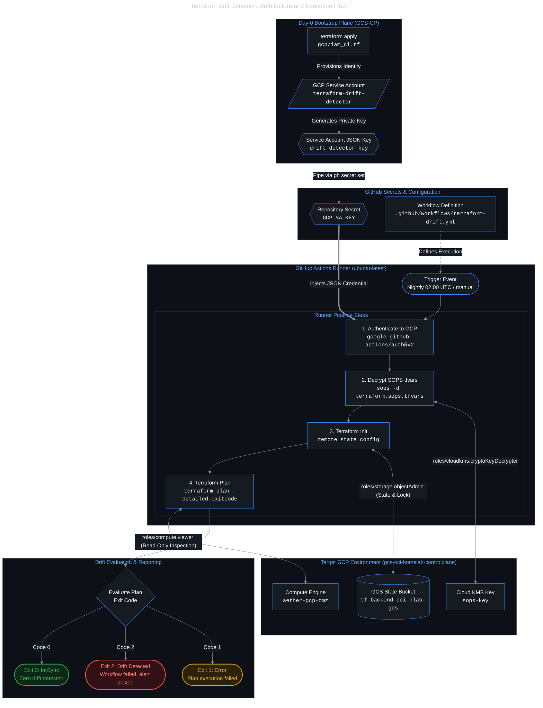

# GCP CI identity and Terraform drift detector runbook

> **Scope:** Setup and credential rotation for the least-privilege GCP service account used by GitHub Actions for nightly Terraform drift detection.
> **Target repository:** `Project Aether`
> **Identity source:** `GCS-CP` bootstrap repository (`/home/owl/Projects/GCS-CP/gcp/iam_ci.tf`)
> **Related issue / chore:** OPS-05 · ADR-012

## 1. Context and architecture

To prevent configuration drift across clouds without crossing the Day-0 bootstrap boundary ([ADR-012](../adr/012-oci-monorepo-consolidation.md)), the CI identity is provisioned in the `GCS-CP` repository.

The state backend bucket (`tf-backend-oci-hlab-gcs`) and Cloud KMS keyring (`sops-key`) are Day-0 assets managed by `GCS-CP`. Placing CI IAM roles in `Project Aether` would create circular dependencies and grant GitHub Actions broader IAM permissions over GCP than necessary.

The service account follows least privilege:
- Viewer access (`roles/compute.viewer`) to inspect compute instances and firewall rules.
- Storage object admin (`roles/storage.objectAdmin`) to read and lock remote state during `terraform plan`.
- Cloud KMS decryption (`roles/cloudkms.cryptoKeyDecrypter`) to decrypt `.sops.tfvars`.

It cannot create, modify, or destroy compute resources.

### Architecture and execution flow



## 2. Service account specification

- Service account ID: `terraform-drift-detector`
- Email: `terraform-drift-detector@gcs-oci-homelab-controlplane.iam.gserviceaccount.com`
- Assigned roles:
  - `roles/compute.viewer` on project `gcs-oci-homelab-controlplane` (inspects compute instance metadata and firewall rules)
  - `roles/storage.objectAdmin` on bucket `tf-backend-oci-hlab-gcs` (reads remote state and manages lock objects during `terraform plan`)
  - `roles/cloudkms.cryptoKeyDecrypter` on key `projects/gcs-oci-homelab-controlplane/locations/global/keyRings/sops/cryptoKeys/sops-key` (decrypts `terraform.sops.tfvars`)

## 3. Terraform definition in GCS-CP (`gcp/iam_ci.tf`)

```hcl
# Service Account for GitHub Actions Drift Detection
resource "google_service_account" "drift_detector" {
  account_id   = "terraform-drift-detector"
  display_name = "CI Drift Detector Service Account"
  description  = "Least-privilege identity used by GitHub Actions for nightly terraform plan drift detection"
}

# 1. Compute Viewer (Inspection only)
resource "google_project_iam_member" "compute_viewer" {
  project = var.project_id
  role    = "roles/compute.viewer"
  member  = "serviceAccount:${google_service_account.drift_detector.email}"
}

# 2. GCS State Bucket Access & State Locking
resource "google_storage_bucket_iam_member" "state_object_admin" {
  bucket = var.state_bucket_name
  role   = "roles/storage.objectAdmin"
  member = "serviceAccount:${google_service_account.drift_detector.email}"
}

# 3. KMS Decryption for SOPS tfvars
resource "google_kms_crypto_key_iam_member" "sops_decrypter" {
  crypto_key_id = google_kms_crypto_key.sops_key.id
  role          = "roles/cloudkms.cryptoKeyDecrypter"
  member        = "serviceAccount:${google_service_account.drift_detector.email}"
}

# 4. Service Account Key Generation
resource "google_service_account_key" "drift_detector_key" {
  service_account_id = google_service_account.drift_detector.name
}

# Sensitive Output for GitHub Actions Secret Injection
output "github_secret_gcp_sa_key" {
  description = "Base64-decoded JSON credentials for GitHub Secret GCP_SA_KEY"
  value       = base64decode(google_service_account_key.drift_detector_key.private_key)
  sensitive   = true
}
```

## 4. Operational procedures

### Setting or rotating the GitHub secret

From the `GCS-CP/gcp/` directory, apply the configuration and pipe the secret directly to GitHub using the CLI:

```bash
cd /home/owl/Projects/GCS-CP/gcp

# 1. Validate and apply changes
terraform plan
terraform apply

# 2. Pipe key directly to GitHub Secret (avoid writing unencrypted key to disk)
terraform output -raw github_secret_gcp_sa_key | \
  gh secret set GCP_SA_KEY --repo ChetanThapliyal/Project-Aether

# 3. Verify secret presence
gh secret list --repo ChetanThapliyal/Project-Aether
```

### Verifying service account permissions locally

To smoke-test the credentials without waiting for CI:

```bash
# Export key to temporary file
TMP_KEY=$(mktemp)
terraform -chdir=/home/owl/Projects/GCS-CP/gcp output -raw github_secret_gcp_sa_key > "$TMP_KEY"

# Authenticate as SA
gcloud auth activate-service-account --key-file="$TMP_KEY"

# Test Compute Viewer
gcloud compute instances list --project=gcs-oci-homelab-controlplane

# Test State Storage Access
gcloud storage ls gs://tf-backend-oci-hlab-gcs/gcp-dmz/

# Test SOPS Decryption
sops -d infrastructure/terraform/02-gcp-dmz/terraform.sops.tfvars > /dev/null && echo "SOPS Decrypt SUCCESSFUL!"

# Clean up
rm -f "$TMP_KEY"
gcloud config set account thapliyal.chetan93@gmail.com
```

### Triggering a manual drift check

Once `.github/workflows/terraform-drift.yml` is pushed to GitHub `main`:

```bash
gh workflow run "Terraform Drift Detection" --repo ChetanThapliyal/Project-Aether
gh run watch --repo ChetanThapliyal/Project-Aether
```
