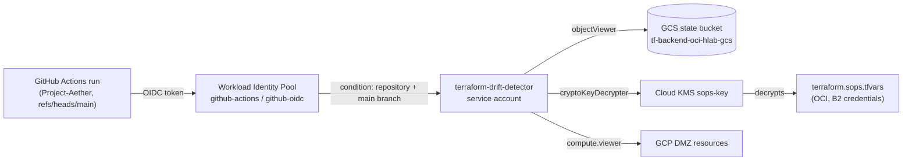

# Terraform drift detection runbook (keyless CI)

> **Scope:** How the nightly Terraform drift check works, how its GCP identity is set up, and how to run, test, extend and troubleshoot it.
> **Workflow:** `.github/workflows/terraform-drift.yml`
> **Identity source:** `GCS-CP` repository (`gcp/iam_ci.tf`), applied by the operator
> **History:** OPS-05 (first version, JSON key, one root) → FND-05, 2026-11-13 (keyless, three roots, public-safe output)

## 1. What it does

Every night at 02:00 UTC (07:30 IST), GitHub Actions runs a read-only `terraform plan` for each cloud root:

| Root | Provider | Credentials in CI |
|------|----------|-------------------|
| `01-oci-compute` | oracle/oci | API key (PEM) from `terraform.sops.tfvars`, decrypted via KMS |
| `02-gcp-dmz` | hashicorp/google | the drift service account itself (OIDC) |
| `04-backblaze-b2` | Backblaze/b2 | application key from `terraform.sops.tfvars` |

A job passes when the plan finds no changes, fails when it finds drift, and fails when the plan errors. GitHub emails the repository owner about failed scheduled runs.

`03-homelab` is **not** checked in CI. See §6.

## 2. Identity: GitHub OIDC → Workload Identity Federation

No key is stored anywhere. Each run exchanges GitHub's OIDC token for a short-lived GCP credential.



Defined in GCS-CP `gcp/iam_ci.tf`:

| Resource | Purpose |
|----------|---------|
| `google_iam_workload_identity_pool.github` (`github-actions`) | Trust boundary for GitHub tokens |
| `google_iam_workload_identity_pool_provider.github` (`github-oidc`) | Issuer `https://token.actions.githubusercontent.com`; `attribute_condition` allows only `ChetanThapliyal/Project-Aether` on `refs/heads/main` |
| `google_service_account_iam_member.drift_detector_wif` | `roles/iam.workloadIdentityUser` for that repository's principal set |
| `google_storage_bucket_iam_member.state_backend` | `roles/storage.objectViewer`: read state only. Plans run with `-lock=false`, so nothing writes |
| `google_kms_crypto_key_iam_member.sops_decrypter` | `roles/cloudkms.cryptoKeyDecrypter` on `sops-key` |
| `google_project_iam_member.compute_viewer` | `roles/compute.viewer` for the DMZ's resources |
| `google_project_service.iamcredentials`, `.sts` | APIs that federation needs |

Values the workflow uses (from `terraform output` in GCS-CP):

```text
workload_identity_provider: projects/776522028840/locations/global/workloadIdentityPools/github-actions/providers/github-oidc
service_account:            terraform-drift-detector@gcs-oci-homelab-controlplane.iam.gserviceaccount.com
```

Forks and pull-request runs can't get a credential: their `ref` isn't `refs/heads/main`. The workflow runs only on `schedule` and `workflow_dispatch`.

**Blast radius.** The account can decrypt every SOPS file encrypted to `sops-key`, not just the tfvars. That's why it's limited to `main` and to short-lived tokens, and why it must never run on pull requests.

## 3. What the workflow publishes

The repository is public, and so are its Actions logs. The workflow never prints a plan body:

- No drift: `✅ <root>: no drift.`
- Drift: `⚠️ <root>: drift detected.` followed by one line per resource, action and address only, for example ``- `update` google_compute_firewall.allow_icmp_ipv6``. Attribute values never appear.
- Plan error: `❌ <root>: plan failed.` plus Terraform's `Error` lines only.

Decrypted tfvars are written with `umask 077` and deleted before any output is produced.

## 4. Running it

```bash
R=ChetanThapliyal/Project-Aether
gh workflow run terraform-drift.yml -R $R
gh run watch -R $R
gh run view <run-id> -R $R --log | grep -E "no drift\.|drift detected|plan failed"
```

Local equivalent (operator credentials, same flags):

```bash
task tf:plan DIR=01-oci-compute   # or 02-gcp-dmz, 03-homelab, 04-backblaze-b2
```

## 5. Testing that drift is caught

Use something Terraform fully manages. Labels are a bad test: google provider v5+ manages only the labels declared in config, and the DMZ declares none, so a console label never shows as drift.

```bash
P=gcs-oci-homelab-controlplane
gcloud compute firewall-rules update aether-gcp-dmz-allow-icmp-ipv6 --project $P --description "drift test (temporary)"
gh workflow run terraform-drift.yml -R $R   # expect 02-gcp-dmz to fail, listing `update` google_compute_firewall.allow_icmp_ipv6
gcloud compute firewall-rules update aether-gcp-dmz-allow-icmp-ipv6 --project $P \
  --description "Permit ICMPv6 echo requests (ping) for latency & diagnostic checks"
gh workflow run terraform-drift.yml -R $R   # expect all green
```

Last run on 2026-11-13: the drift run failed exactly on that resource, and the run after the revert was all green.

## 6. Why `03-homelab` is checked by hand

The bpg/proxmox provider reads each VM's disk volume during `plan`. Proxmox allows that only with `VM.Config.Disk` on `/vms/<id>`, a privilege that also attaches, detaches and resizes disks. A `PVEAuditor` token reads the API (200), is refused writes (403), and fails the plan (403). Giving CI that privilege, plus a tailnet path to the Proxmox API, wasn't worth it for VMs that rarely change outside Terraform.

So once a month, from a machine on the LAN or tailnet:

```bash
task tf:plan DIR=03-homelab    # expect "No changes"
```

Running drift checks from Kestra on the OCI host was also rejected: it would put a long-lived, KMS-capable GCP key on an internet-facing host.

## 7. Adding a root

1. The provider's credentials must be usable without files on a workstation. Put them in the root's `terraform.sops.tfvars`, as `01-oci-compute` does with `private_key`.
2. If the root needs GCP read access beyond `compute.viewer`, add the narrowest role in GCS-CP `gcp/iam_ci.tf`.
3. Add the directory to the workflow's `matrix.dir`.
4. Run the workflow and check that the new job is green.

## 8. Troubleshooting

| Symptom | Cause / fix |
|---------|-------------|
| `gh secret delete …` returns 404 | `gh` uses the repository of the current folder. Pass `-R ChetanThapliyal/Project-Aether`. |
| Auth step: `unable to generate access token` / `Permission denied` on `iam.serviceAccounts.getAccessToken` | The run isn't on `main`, the repository name changed, or the WIF binding was removed. Check `attribute_condition` and `drift_detector_wif` in GCS-CP. |
| `Error acquiring the state lock` | A plan ran without `-lock=false`. The account is read-only by design. |
| SOPS: `failed to decrypt` | KMS binding missing, or the file wasn't encrypted to `sops-key`. Check `.sops.yaml` and `sops_decrypter`. |
| OCI: `can not create client, bad configuration` | `private_key` missing or malformed in `01-oci-compute/terraform.sops.tfvars`. It must be the PEM block only. The OCI-generated file ends with an extra `OCI_API_KEY` label line, which must be dropped. |
| Annotation about Node.js 20 | An action is on an old major version. The workflow uses `checkout@v7`, `auth@v3`, `setup-terraform@v4`. |
