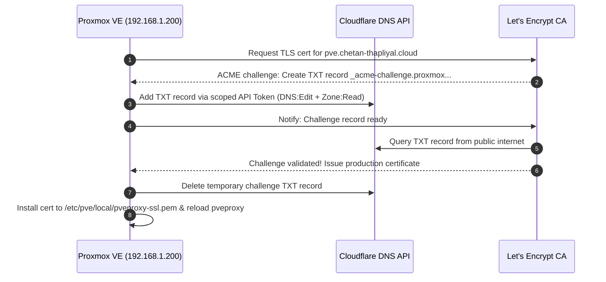

# Proxmox VE TLS certificate automation with Cloudflare DNS-01 ACME

> **Scope:** Automating trusted Let's Encrypt TLS certificates for homelab Proxmox VE on internal private IP (`192.168.x.xxx`) using Cloudflare DNS-01 challenge.
> **Target Domain:** `pve.chetan-thapliyal.cloud`
> **Status:** Active and automated via `pve-daily-update.timer`
> **Associated Issue:** Resolves #6 (OPS-04)

## 1. Overview and architecture

By default, Proxmox VE provisions a self-signed TLS certificate for its management web server and API (`pveproxy` on port 8006). This triggers browser certificate warnings and requires `insecure = true` in Terraform provider configurations.

Because the homelab hypervisor resides on an internal RFC 1918 LAN (`192.168.x.xxx`), standard HTTP-01 ACME validation cannot be used without forwarding public port 80 on the home router, which would expose the hypervisor to internet scanners.

A DNS-01 ACME challenge avoids this by validating domain ownership through Cloudflare's public DNS API without requiring inbound firewall ports.



## 2. Prerequisites

1. Domain managed on Cloudflare (`chetan-thapliyal.cloud`).
2. Proxmox VE host (`192.168.x.xxx`) with outbound internet connectivity to Cloudflare API and Let's Encrypt.
3. SSH root access to Proxmox VE host.

## 3. Step-by-step implementation

### Step 1: Configure Cloudflare DNS records

In the Cloudflare dashboard for `chetan-thapliyal.cloud`:

1. Internal A record:
   - Type: `A`
   - Name: `pve` (resolves to `pve.chetan-thapliyal.cloud`)
   - IPv4 address: `192.168.x.xxx`
   - Proxy status: DNS only (gray cloud, not proxied, because this is an RFC 1918 private IP)
   - TTL: Auto

2. CAA authorization record (required if CAA records exist):
   If you have a CAA record restricting issuance (such as `0 issue "pki.goog"`), Let's Encrypt rejects requests unless explicitly permitted:
   - Type: `CAA`
   - Name: `@` (or `chetan-thapliyal.cloud`)
   - Tag: `issue`
   - CA domain name: `letsencrypt.org`

### Step 2: Create scoped Cloudflare API token

Go to Cloudflare Dashboard > My Profile > API Tokens > Create Token:

1. Select Create Custom Token.
2. Token name: `Proxmox Homelab ACME DNS`
3. Permissions:
   - Zone > DNS > Edit (creates and deletes challenge TXT records)
   - Zone > Zone > Read (looks up the zone ID by domain name)
4. Zone resources:
   - Include > Specific zone > `chetan-thapliyal.cloud`
5. Client IP filtering and TTL: Leave blank to allow renewals across dynamic WAN IPs and prevent token expiration.
6. Select Continue to summary > Create Token and copy the generated token (`CF_Token`).

### Step 3: Register ACME account in Proxmox

SSH into the Proxmox host (`ssh root@192.168.x.xxx`) and register an account with Let's Encrypt production:

```bash
pvenode acme account register default your-email@example.com
```

When prompted:
```text
Directory endpoints:
0) Let's Encrypt V2 (https://acme-v02.api.letsencrypt.org/directory)
1) Let's Encrypt V2 Staging (https://acme-staging-v02.api.letsencrypt.org/directory)
2) Custom
Enter selection: 0
```
Accept terms of service when prompted (`y`).

### Step 4: Configure Cloudflare DNS challenge plugin

In the Proxmox CLI, the `--data` flag requires a file path containing the API credentials:

```bash
# 1. Write the token securely to a temp file
echo "CF_Token=YOUR_CLOUDFLARE_API_TOKEN" > /tmp/cf.txt
chmod 600 /tmp/cf.txt

# 2. Register the Cloudflare DNS challenge plugin
pvenode acme plugin add dns cloudflare --api cf --data /tmp/cf.txt

# 3. Clean up the temp file
rm /tmp/cf.txt
```

Alternatively, configure this in the Proxmox web UI under Datacenter > ACME > Challenge Plugins > Add with plugin ID `cloudflare`, DNS API `cf`, and API data `CF_Token=...`.

### Step 5: Assign domain and order certificate

```bash
# Assign the domain and plugin to the node
pvenode config set --acmedomain0 domain=pve.chetan-thapliyal.cloud,plugin=cloudflare

# Request and issue the certificate
pvenode acme cert order
```

**Expected Output:**
```text
Loading ACME account details
Placing ACME order
The validation for pve.chetan-thapliyal.cloud is pending!
Adding record
Add TXT record: _acme-challenge.pve.chetan-thapliyal.cloud
Sleeping 30 seconds to wait for TXT record propagation
Triggering validation
Status is 'valid', domain 'pve.chetan-thapliyal.cloud' OK!
Remove TXT record: _acme-challenge.pve.chetan-thapliyal.cloud
All domains validated!
Downloading certificate
Setting pveproxy certificate and key
Restarting pveproxy
Task OK
```

## 4. Verification

1. Browser test:
   Navigate to `https://pve.chetan-thapliyal.cloud:8006`.
   - The browser should load the web UI with a valid Let's Encrypt TLS certificate without warnings.
2. CLI test:
   ```bash
   curl -Iv https://pve.chetan-thapliyal.cloud:8006
   ```
   Certificate verification must succeed without `-k` or `--insecure`.

## 5. Automated renewals

Proxmox VE manages renewals through the `pve-daily-update.timer` systemd timer and its companion service `pve-daily-update.service`. The service runs daily and checks if the certificate expires within 30 days. When renewal is due, Proxmox contacts the Cloudflare API, completes the DNS-01 challenge, writes the new certificate to `/etc/pve/local/pveproxy-ssl.pem`, and reloads `pveproxy`.

### Verification commands:
```bash
# Check timer status
systemctl status pve-daily-update.timer

# Test renewal check (will skip if cert is not yet within 30-day window)
pvenode acme cert renew

# Force immediate renewal dry-run (if needed)
pvenode acme cert renew --force
```

## 6. Terraform integration (OPS-04)

With a verified TLS certificate in place, homelab Terraform configurations can strictly enforce TLS validation without `insecure = true`.

### 1. `infrastructure/terraform/03-homelab/provider.tf`
```hcl
provider "proxmox" {
  endpoint  = var.proxmox_api_url
  api_token = "${var.proxmox_api_token_id}=${var.proxmox_api_token_secret}"
  insecure  = false # Enforce valid TLS certificate verification

  ssh {
    agent = true
  }
}
```

### 2. `infrastructure/terraform/03-homelab/terraform.sops.tfvars`
```hcl
proxmox_api_url = "https://pve.chetan-thapliyal.cloud:8006"
```

## 7. Common pitfalls and troubleshooting

| Error | Root Cause | Fix |
|---|---|---|
| `invalid domain` | Typo in domain extension (such as `.com` instead of `.cloud`) | Re-run `pvenode config set --acmedomain0 domain=pve.chetan-thapliyal.cloud,plugin=cloudflare` |
| `can't open 'CF_Token=...' - No such file` | Proxmox `--data` flag expects a file path, not inline string | Write `CF_Token=...` to a temp file and pass `/path/to/file` |
| `CAA record prevents issuance` | Cloudflare CAA record only allows another CA (such as `pki.goog`) | Add CAA record with tag `issue` and value `letsencrypt.org` |
| `Cannot find zone id` | Cloudflare API token lacks Zone read permission | Add Zone > Zone > Read permission to the API token |
